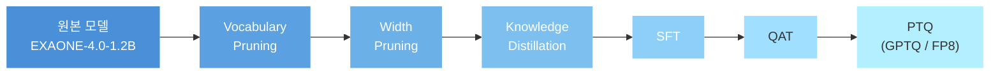
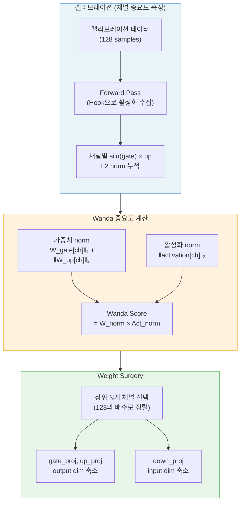
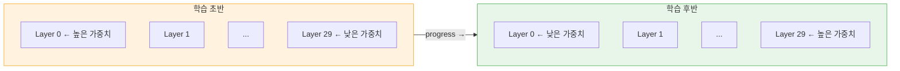

# Aimers 8기 — EXAONE 경량화 프로젝트 복기록

> **작성자:** 정희승  
> **작성일:** 2026.02.25  
> **대상 모델:** EXAONE-4.0-1.2B

---

## 1. 경량화 파이프라인 개요

본 프로젝트에서는 EXAONE-4.0-1.2B 모델을 대상으로 아래와 같은 순서로 경량화 기법들을 적용하였다. 각 기법의 적용 순서는 기법 간 상호작용과 민감도를 고려하여 결정하였다.

전체 파이프라인은 `run_pipeline.py`를 통해 단일 명령으로 자동 실행되도록 구성하였다. 학습 데이터는 사전에 Pruning 캘리브레이션용(wp\_calib), KD 학습용(kd\_train), FP8 캘리브레이션용(fp8\_calib)의 3개 disjoint split으로 분리하여, 각 단계 간 데이터 오염을 방지하였다.

### 1.1 기법별 적용 근거

| 기법 | 적용 시점 | 적용 이유 | 해당 시점에 적용한 근거 | 비고 |
|:---|:---|:---|:---|:---|
| **Vocabulary Pruning** | 최초 | 사용하지 않는 토큰을 배제하여 임베딩 크기 축소 | 다른 기법의 적용에 영향을 주지 않으므로, 가장 먼저 독립적으로 수행 가능 | — |
| **Width Pruning** | Vocab Pruning 직후 | FFN의 intermediate 차원을 줄여 직접적인 연산 가속 달성 | 행렬 축소는 모델 구조에 민감한 작업이므로, 다른 경량화의 영향을 받기 전에 적용 | Wanda 중요도 기반 |
| **Knowledge Distillation** | Pruning 직후 | Pruning으로 인한 성능 손실을 복구 | 구조 변경이 완료된 직후가 손실 복구의 최적 시점 | LoRA 병행 가능 |
| **LoRA (KD 병행)** | KD 대체/보조 | KD 최적화를 더 효율적으로 수행 | Rank에 따라 성능–효율 트레이드오프 조절 가능 | Rank별 사용 여부 결정 |
| **SFT** | PTQ/QAT 이전 | 평가 서버 벤치마크에 최적화된 모델 확보 | 양자화 이전 사실상 최종 튜닝 단계 | — |
| **QAT** | 양자화 직전 | 양자화 오차 사전 감소 | 양자화 오차에 적응하도록 사전 학습하는 일반적 시점 | — |
| **PTQ (GPTQ / FP8)** | 최종 | 모델 크기 및 추론 속도 최적화 | 모든 튜닝이 완료된 후 최종 압축 | — |

---

## 2. 주요 기여

본인은 **Pruning**과 **Knowledge Distillation** 구현, 그리고 KD 기반 최적화 방식의 개선에 주로 기여하였다.

### 2.1 Pruning

Pruning 단계에서는 다양한 기법을 검토한 뒤, 평가 서버 환경에서의 제약(커스텀 커널 불가)을 고려하여 **Structured Pruning**을 채택하였다. Structured Pruning은 실제 행렬 차원을 줄이므로, 별도의 희소 연산 지원 없이도 직접적인 추론 속도 향상을 얻을 수 있기 때문이다.

#### Depth Pruning 대신 Width Pruning을 선택한 이유

Depth Pruning이 KD 이후 성능 회복에 더 효과적이라는 연구 결과가 존재함에도 불구하고(Shortened LLaMA, Kim et al. 2024), 본 프로젝트에서는 **Width Pruning**을 선택하였다. 그 근거는 [2.3절](#23-hidden-state-학습)에서 상세히 서술한다.

Width Pruning은 Attention보다 FFN 쪽에 우선적으로 적용하는 것이 성능 방어에 유리하다는 선행 연구를 참고하여, **FFN layer의 gate\_proj / up\_proj / down\_proj에 집중 적용**하였다. 채널 중요도 측정에는 가중치 L2 norm과 활성화 L2 norm을 결합하는 **Wanda** 방식을 사용하였으며, 128개 캘리브레이션 샘플로부터 채널별 통계를 수집하였다.

별도로, GQA 구조를 고려한 **KV 그룹 단위의 Attention Head Pruning** 기능도 구현하였다. 전체 레이어에서의 평균 가중치 norm을 기준으로 중요도가 낮은 KV 그룹을 일괄 제거하는 방식이다. 최종 제출에는 FFN Width Pruning만 사용하였으나, 필요 시 Attention 차원도 추가로 축소할 수 있도록 준비해 두었다.

### 2.2 Knowledge Distillation

원본 모델(EXAONE-4.0-1.2B 또는 Vocab Pruned 버전)을 Teacher Model, Pruning 직후 모델을 Student Model로 설정하여 KD를 수행하였다.

#### 2.2.1 KD with LoRA

사전학습이 완료된 가중치를 추가 최적화하는 상황이므로, **LoRA**를 활용하여 연산 효율성과 성능 간의 트레이드오프를 조절할 수 있었다. LoRA의 rank를 조절함으로써 더 세밀한 수준의 트레이드오프가 가능했다.

다만, 대상 모델의 크기가 비교적 작아(1.2B) 고성능 GPU 사용 시에도 비용 부담이 크지 않았으므로, 최종적으로는 **LoRA 없이 Direct Training으로 KD를 진행**하는 것이 성능 면에서 더 유리하다고 판단하였다.

#### 2.2.2 Minitron 연구 참고

대형 모델을 소형 모델로 증류할 때, 바로 증류하지 않고 중간 크기의 모델을 거쳐 단계적으로 증류하는 **Minitron** 방식을 참고하여 프로젝트에 적용하였다.

**Temperature 설정:** Minitron 연구에 따르면 LLM에서는 일반적인 KD와 달리 T ≤ 1.0이 최적이므로, Temperature를 **1.0**으로 설정하였다.

**단계적 모델 압축 (미시도):** Minitron이 15B → 8B → 4B 순으로 압축한 것과 유사하게, intermediate size를 4096 → 3840 → 3584 수준으로 단계적으로 줄이는 방식을 계획하였다. 그러나 각 단계에서 모델이 원본 성능의 99% 수준까지 회복하지 못하여 실질적으로 시도하지 못하였다.

#### 2.2.3 Adaptive KL Divergence (AKL)

일반적인 KD에서는 Forward KL(FKL) divergence만 사용하지만, FKL과 Reverse KL(RKL)은 서로 다른 특성을 가진다. FKL은 Teacher 분포의 전체적인 형태를 모방하는 데 유리하고(mean-seeking), RKL은 Teacher 분포의 주요 모드에 집중하는 데 유리하다(mode-seeking).

본 프로젝트에서는 AKL 논문을 참고하여, 학습 초반에는 FKL 위주로 전체적인 분포를 학습하고, 학습 후반으로 갈수록 RKL 비율을 높여 핵심 토큰에 집중하는 **동적 전환 방식**을 구현하였다. 구체적으로, 혼합 비율 β를 학습 진행도에 따라 1.0에서 0.0으로 선형 감소시켜 `L_KD = β·FKL + (1−β)·RKL`로 계산하였다.

#### 2.2.4 Dynamic Alpha (Minitron 방식)

KD에서 Logit Loss와 Hidden State Loss는 스케일이 상이하여, 고정된 가중치(α)로는 두 loss의 기여를 균형 있게 조절하기 어렵다. Minitron에서 영감을 받아, 학습 중 두 loss의 비율을 실시간으로 계산하여 **Hidden State Loss의 가중치를 자동 조절**하는 Dynamic Alpha를 구현하였다.

설정된 α 비율(예: logit 0.7, hidden 0.3)을 유지하면서도, 실제 loss 값의 스케일 차이를 보상하여 의도한 비율대로 기여하도록 하는 방식이다. 이를 통해 학습 초반에 hidden loss가 지나치게 크거나 작아서 logit loss의 학습을 방해하는 문제를 완화할 수 있었다.

#### 2.2.5 Muon Optimizer (시도 후 미채택)

AdamW 외에 더 효과적인 최적화를 탐색하기 위해 **Muon Optimizer**를 구현하여 실험하였다. Muon은 steepest descent 방향을 spectral norm으로 정규화하는 방식으로, pretraining에서 AdamW 대비 빠른 수렴을 보인다고 보고된 optimizer이다.

그러나 실험 단계에서 **loss가 diverge하는 현상**이 관찰되었다. 이는 Muon이 loss landscape가 비교적 매끄러운 pretraining 환경에 최적화되어 있기 때문으로, pruning 후 손상된 가중치를 복구하는 fine-tuning 성격의 KD 학습에는 적합하지 않은 것으로 판단하였다.

추가로, Attention layer에 특화된 **Muon-Clip** 변형도 함께 구현하였다. 원래 계획은 Width Pruning으로 FFN을 축소한 뒤, Attention Head도 추가로 프루닝하고 Muon-Clip으로 해당 부분의 성능을 복구하는 것이었다. 그러나 Muon 자체가 성능 복구 튜닝에 적합하지 않았고, Attention Pruning도 최종적으로 적용하지 않았으므로 시도하지 않았다.

### 2.3 Hidden State 학습

KD는 모델의 최종 출력(logit) 뿐만 아니라 **중간 Hidden Layer의 출력**도 학습 대상으로 삼을 수 있다. 본 프로젝트에서는 이 점을 적극적으로 활용하였다.

#### Depth Pruning 기각 사유

Depth Pruning은 디코더 레이어 자체를 삭제하므로, Teacher와 Student 간 레이어 수가 달라진다. 이 경우 Teacher의 Hidden State 중 어떤 레이어를 Student의 어떤 레이어에 매핑할지 결정해야 하며, n개의 레이어를 삭제했다면 ₃₀Cₙ 가지의 경우의 수를 탐색해야 하는 **복잡한 하이퍼파라미터 최적화 문제**가 된다. 이를 피하기 위해 레이어 수를 유지하는 Width Pruning을 선택하였다.

> Width Pruning의 경우 Teacher와 Student의 레이어 수가 동일하므로, 각 레이어의 Hidden State를 **1:1로 직접 매핑**하여 학습할 수 있다.

#### 2.3.1 Cosine Similarity Loss

기존에는 Hidden State 간 거리를 MSE Loss로 측정하였으나, **Cosine Similarity Loss**가 scale-invariant하고 gradient가 더 안정적이라는 연구(CoDIR)를 반영하여 변경하였다.

#### 2.3.2 Progressive Layer-Wise KD

초반 레이어가 학습을 통해 출력을 바꾸게 되면, 그 위에 쌓인 후반 레이어의 기존 학습이 무의미해지는 **Covariate Shift** 문제를 우려하였다. 일반적으로 Covariate Shift는 Normalization Layer를 추가하여 극복하지만, 대회 환경상 모델 구조 변경이 어려웠다.

이에 대한 대안으로, Loss 계산 시 **레이어별 가중 평균**을 사용하되, 학습 초반에는 앞쪽 레이어에 높은 가중치를, 학습이 진행될수록 뒤쪽 레이어에 높은 가중치를 부여하는 **Progressive 스케줄링**을 설계하였다. 구체적으로는 가우시안 형태의 가중치 분포를 사용하여, 학습 진행도(progress)에 따라 peak 위치를 앞에서 뒤로 이동시켰다.

그러나 예상과 달리 이 방식이 Loss를 유의미하게 줄이지는 못하였다. 코드 설계상의 문제가 있었는지, 또는 추가 학습 기능(2.4절)과의 상호작용으로 효율이 저하된 것인지 추가 분석이 필요하다.

### 2.4 추가 학습 (Interactive Training Loop)

Loss 변화를 그래프로 실시간 시각화하여, 학습 완료 후 사용자가 **추가 epoch 수를 입력**하면 이어서 학습을 진행할 수 있도록 구현하였다. Optimizer와 Scheduler의 상태를 checkpoint로 보존하여, 추가 학습 시 loss spike 없이 매끄럽게 이어지도록 하였다.

GPU 자원이 제한된 상황에서, 적은 epoch으로 먼저 학습한 뒤 Loss 그래프를 확인하고 필요한 만큼만 추가 학습을 수행할 수 있는 **자원 친화적인 기능**이다.

---

## 3. 향후 개선 제안

### 3.1 Teacher Model 출력 캐싱

Teacher Model은 학습 중 가중치가 변하지 않으므로 출력이 항상 동일하다. 따라서 매 epoch마다 Teacher의 forward pass를 반복하지 않고, **학습 전에 한 번만 forward pass를 수행하여 출력을 저장**해 두면 학습 시간을 상당히 단축할 수 있다. 이는 저장 공간과 학습 시간 간의 트레이드오프이지만, 1.2B 규모의 모델에서는 충분히 실용적이다.

### 3.2 Progressive Layer-Wise KD 개선

Covariate Shift 완화를 위해 제안한 가중 평균 방식이 큰 효과를 내지 못하였다. 대안으로, epoch 수를 레이어 수의 배수로 설정하고 **한 epoch에서는 한 레이어만 학습하는 hard 스케줄링** 방식도 고려하였으나, 요구되는 epoch 수가 과도하여 시도하지 않았다.

추가 학습 기능(2.4절)과 결합하여, 두 가지 접근 모두 실질적으로 작동하는 방식을 고안할 필요성을 느낀다. 나아가, Progressive KD의 효과를 제대로 검증하려면 Covariate Shift 자체를 **탐지하고 정량화하는 방법**을 먼저 마련했어야 했다. 예컨대 각 레이어의 Hidden State 분포 변화량을 학습 step마다 추적하여, Covariate Shift가 실제로 발생하고 있는지, 그리고 Progressive 스케줄링이 이를 얼마나 완화하는지를 수치로 확인할 수 있었다면 더 근거 있는 개선이 가능했을 것이다.

### 3.3 Pretraining 데이터셋을 활용한 KD

본 프로젝트에서는 MANTA-1M을 비롯한 여러 파인튜닝용 대화형 데이터셋을 조합하여 KD를 수행하였다. 그러나 KD의 본질은 Teacher의 지식을 Student에 전이하는 것이므로, **pretraining에 사용되는 대규모 코퍼스**(예: 웹 텍스트, 위키피디아 등)로 KD를 수행했다면 모델의 일반적인 언어 능력을 더 넓게 복구할 수 있었을 가능성이 있다. 대화형 데이터에 특화된 현재 방식과 비교하여, pretraining 데이터 기반 KD가 벤치마크 일반화 성능에 어떤 차이를 보이는지 실험해 볼 가치가 있다.

또한 pretraining 데이터의 넓고 균일한 분포가 batch 간 gradient 분산을 줄여, Muon 계열 optimizer의 안정성이 개선될 여지가 있는지 함께 검토해 볼 수 있다.

---

## 부록: 참고 문헌

| 약칭 | 논문 | 관련 섹션 |
|:---|:---|:---|
| Shortened LLaMA | Kim et al. (2024), *Shortened LLaMA: Depth Pruning for Large Language Models with Comparison of Retraining Methods* | 2.1, 2.3 |
| Minitron | NVIDIA (2024), *Minitron: Compact Language Models via Pruning and Knowledge Distillation* | 2.2.2, 2.2.4 |
| AKL | Adaptive KL Divergence — Forward/Reverse KL 동적 결합 | 2.2.3 |
| CoDIR | Cosine Similarity 기반 Hidden State Distillation | 2.3.1 |
| Wanda | Sun et al. (2024), *A Simple and Effective Pruning Approach for Large Language Models* | 2.1 |
| Muon | Jordan et al., *Muon: An optimizer for hidden layers in neural networks* | 2.2.5 |